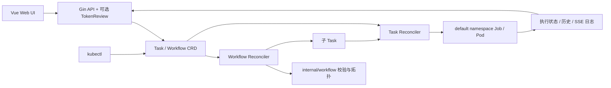

# KubeTask — 云原生任务调度平台

## 项目计划书与实现进度

最后核对：2026-10-26。MVP 与 P2.0/P2.1 已实现，P2.2 认证部分完成；P2.3 全局通用 Webhook MVP 已实现，真实集群验收待完成。版本号为规划标签，不表示已发布；当前 Chart/image 默认标签仍为 v0.1.0。当前验证结果见 [项目状态](docs/PROJECT_STATUS.md)，历史节点保留其当时的测试数量与验收范围。

---

## 一、项目概述

| 项目 | 内容 |
|------|------|
| 项目名称 | KubeTask（智能云原生任务调度系统） |
| 版本 | v0.1.0 为当前 Chart/image 默认标签，v0.2.0 规划进行中 |
| 开发语言 | Go 1.27.3 |
| 核心目标 | 基于 Kubernetes 构建生产可用、易部署、智能调度的分布式任务调度平台，解决传统 CronJob 在企业中面临的可见性差、运维复杂、调度不智能、缺乏依赖编排等问题。 |
| 项目定位 | **轻量级 + 可扩展 + 学习深度优先**，从零搭建每一行代码，适用于中小团队、边缘计算（k3s）、云原生学习与生产实践 |
| 交付形态 | Controller + Gin + Vue 静态资源同镜像；Helm / k3s 部署脚本；kubectl 管理 CR |

### 设计哲学

```
KISS 原则 → 先做精，再做全
稳定可靠 → 优于功能丰富
可观测 → 已有 Metrics + 日志 + 全局 Webhook 尽力投递
渐进式 → 每个 Phase 都是独立可用的版本
```

---

## 二、核心问题与解决方案

| 问题 | 传统方案 | KubeTask 方案 |
|------|----------|--------------|
| 定时任务无统一视图 | Shell crontab / Jenkins 分散管理 | Web 管理后台 + 统一 Task CRD |
| 任务失败无告警 | 靠人盯着 | Job 重试与全局 Webhook MVP 已实现；钉钉等渠道规划中 |
| 任务依赖无法编排 | 手写脚本链式调用 | DAG 工作流（YAML 定义） |
| 集群资源浪费 | 固定调度 | 资源水位感知 + 错峰调度（规划） |
| 边缘+云端割裂 | 分别管理 | 多集群统一管理（规划） |
| 任务执行不可观测 | 无日志/无监控 | Prometheus Metrics + 实时日志流式查看 |

---

## 三、版本规划（Roadmap）

```
v0.1.0 MVP ──→ v0.2.0 进阶 ──→ v0.3.0 创新 ──→ v1.0.0 生产
  (6周)     (4周)      (4周)      (持续)
```

每个版本目标为独立可交付；周数为最初工作量估算，当前进度以功能勾选及验收记录为准。

---

## 四、功能需求清单（详细版）

### Phase 1：MVP — 核心实现已具备

以下勾选表示代码已实现；本次测试、历史真实集群验收和部署验收分别记录在 [项目状态](docs/PROJECT_STATUS.md)，不以功能勾选代表生产验证。

#### P1.1 项目骨架
- [x] Kubebuilder v4 项目与 Task CRD（Cron / OneTime / Delay）
- [x] Viper YAML / 环境变量配置，认证项支持显式 Flag 覆盖
- [x] Zap 结构化日志与 AtomicLevel；未提供 HTTP 动态调级接口
- [x] Gin `/healthz`，Manager 独立端口 `/healthz` / `/readyz`

#### P1.2 核心 Controller
- [x] Task → Job 创建、状态同步、Finalizer 删除清理、OwnerReference
- [x] Kubernetes Job Controller 负责 Pod 重试，`backoffLimit` 默认 3；KubeTask 不实现自定义退避算法
- [x] Job Complete/Failed 条件判终态，最近 10 条历史与累计成败计数
- [x] Cron 并发策略 Allow / Forbid / Replace，暂停/恢复与手动触发
- [x] Manager 信号处理与 HTTP 优雅关闭
- [ ] Task 状态变更写入 K8s Events（当前 Controller 使用日志与 status）

#### P1.3 REST API
- [x] Gin 与 Controller 同进程，Task CRUD / trigger / suspend / resume
- [x] 分页与筛选、状态/类型统计、按天执行趋势
- [x] SSE Pod 日志，查询参数 `tail` / `sinceSeconds` / `follow`
- [x] Workflow 创建、列表、详情（含 DAG）与异步删除

#### P1.4 Web 管理界面
- [x] Vue 3 + Vite + 原生 SVG 图表，仪表盘、Task 列表/创建/详情、日志面板
- [x] 任务 YAML 预览、执行历史、触发/暂停/恢复/删除
- [x] Workflow 列表/详情与 Dagre 自动布局、状态着色和节点跳转
- [ ] Task 编辑表单（当前更新 spec 使用 PUT API）

#### P1.5 日志系统
- [x] Kubernetes `GetLogs()`，SSE 逐行传输
- [x] 前端 fetch SSE、自动滚动、行号、级别高亮、搜索过滤

#### P1.6 部署与运维
- [x] Dockerfile：Node 22 → Go 1.27.3 → Alpine 3.21，携带 `/web/dist`
- [x] Helm Chart：CRD 位于 `charts/kubetask/crds/`，Service / Ingress 指向 8080
- [x] k3s 安装脚本 `deploy/k3s/install.sh`
- [x] Makefile（Unix）；Windows 直接调用工具链，命令见 AGENTS.md
- [ ] 当前认证功能的容器/Helm 部署验收及配套权限配置

#### P1.7 测试
- [x] Controller / Handler 的 Ginkgo + envtest，认证、配置与 DAG 单元测试
- [x] HTTP 同端口 SPA/API 与日志连接取消测试
- [x] minikube 真实 Workflow 成功/失败、Pod、SSE 日志与删除清理（2026-10-13 历史验收）
- [x] 前端认证与 DAG 布局 Node 测试
- [ ] 当前代码的 Kind 容器 E2E（`e2e` build tag，默认 Go 测试不运行）

---

### Phase 2：进阶功能（4 周，v0.2.0）

#### P2.0 前后端一体化打包（3 天，前置任务）
- [x] **目标**：Web UI 与后端同进程、同端口交付，Helm / k3s 部署后无需单独部署或运行前端
- [x] **前端构建**：Dockerfile 的 Node 22 构建阶段执行 `npm ci && npm run build`，产物输出到 `web/dist`
- [x] **静态服务**：Gin NoRoute 提供静态文件与 SPA 入口，`/api/*` 不受影响；新增 `web-dir` 配置，默认 `/web/dist`
- [x] **方案定案**：采用方案 B（静态资源随镜像分发，运行时从目录读取），否决方案 A 的 `go:embed` 单二进制方案
- [x] **镜像改造**：Dockerfile 采用 Node → Go → Alpine 多阶段构建，并将 `web/dist` 复制到最终镜像的 `/web/dist`
- [x] **部署修正**：Helm Service / Ingress 指向 8080；README 已恢复同端口访问说明，`deploy/k3s/install.sh` 与部署产物一致
- [x] **本地开发**：开发模式使用 `npm run dev` + Vite 代理；Docker/CI 镜像由 Node 阶段自动产出 `web/dist`；README 已补充 `web-dir` 本地运行说明
- [x] 验收：单容器启动后，同一端口同时可用 Web UI 与 `/api/v1/*`（2026-09-09 在 ECS + minikube 实测通过），镜像体积增量可接受

> 2026-09-04 进展：Dockerfile 已配置为自动构建并携带 `web/dist` 静态资源；方案定案为 B（不做 go:embed）。
> 2026-09-04 节点 2：Gin 静态服务与 `web-dir` 配置完成，`go build` / `go vet` / 全量 `go test` 通过。
> 2026-09-09 节点 3：本机无 Docker，容器级验收未执行；新增 `internal/api/webui_e2e_test.go`，用 envtest + 真实 TCP 端口验证同一 Router 同时服务 SPA 与 API，全量 `go test` 通过。
> 2026-09-09 节点 4：README / README_EN 恢复 Web UI 与同端口交付说明，补充 `web-dir`、部署验证与开发模式；P2.0 全部验收完成。

#### P2.1 DAG 工作流编排（已完成，原估算 2 周）
- [x] **Workflow CRD（扁平 DAG 模式，2026-09-10 定稿）**
  ```yaml
  apiVersion: kubetask.kubetask.io/v1
  kind: Workflow
  metadata:
    name: ci-pipeline
  spec:
    maxParallel: 4
    tasks:
      - name: build
        template: go-build
      - name: unit-test
        dependsOn: [build]
        template: go-test
      - name: e2e
        dependsOn: [build]
        template: go-test
      - name: notify-failure
        dependsOn: [unit-test, e2e]
        # 所有依赖到达终态且至少一个失败时执行
        runOnFailure: true
        template: notify
    taskTemplates:
      go-build:
        type: OneTime
        image: golang:1.27.3
        command: ["go", "build", "./..."]
        backoffLimit: 3
      go-test:
        type: OneTime
        image: golang:1.27.3
        command: ["go", "test", "./..."]
      notify:
        type: OneTime
        image: curlimages/curl
        command: ["sh", "-c", "curl -X POST $WEBHOOK"]
  ```
- [x] **扁平模式要点**
  - `spec.tasks[]` 直接声明 DAG 节点（`name` + `dependsOn`），去掉 `entrypoint` / `templates[dag]` 间接层
  - 节点执行参数二选一：`template` 引用 `spec.taskTemplates` 中的命名模板，或内联 `taskSpec`（复用 TaskSpec，CEL 约束 exactly one）
  - `taskTemplates` 为 map 按名引用；同一模板可被多个节点复用，每次触发创建独立 Task 实例
  - 失败分支：默认节点需依赖全部 `Succeeded` 才执行；任一依赖非成功终态则下游 `Skipped`；`runOnFailure: true` 的节点按专门规则判定（见下）
  - 一个 Workflow CR 即一次运行，子 Task 命名 `<workflow>-<node>`，可确定性幂等创建
- [x] **Workflow Controller**：DAG 拓扑排序 → 按依赖关系依次/并行创建子 Task，子 Task 命名 `<workflow>-<node>`，finalizer 负责删除清理
- [x] **状态机**：Workflow `Pending → Running → Succeeded/Failed`，节点 `Pending/Running/Succeeded/Failed/Skipped`，`status.nodes` 按拓扑序回写
- [x] **失败分支**：`runOnFailure: true` 的节点等待全部依赖到达终态（`Succeeded/Failed/Skipped`）；至少一个依赖为 `Failed/Skipped` 时执行，全部成功时该节点记 `Skipped`（2026-09-15 定稿）；复杂条件表达式顺延 v0.3.0
- [x] **Workflow HTTP API**：`POST/GET/DELETE /api/v1/workflows`，详情返回 DAG 图数据（nodes / edges / order / levels），入口复用 `internal/workflow` 做运行时校验并返回稳定 Reason
- [x] **前端工作流视图**：工作流列表/详情、Dagre 自动布局、状态着色、失败分支虚线、缩放与节点详情、子 Task/日志跳转、运行状态自动刷新

> 2026-09-29 节点 5：Workflow Controller MVP 落地 —— `status.nodes` 初始化与回写、按依赖调度子 Task、`maxParallel` 限流、失败传播与 `runOnFailure` 分支、子 Task 名长度校验（>46 字符提前失败）、删除时清理子 Task 并摘 finalizer；envtest 新增 13 个用例，`go build` / `go vet` / 全量 `go test` 通过。Workflow HTTP API 与前端 DAG 视图仍待开发。

> 2026-09-30 节点 6：Workflow CRD 与 Controller 复查，修复两处潜在问题 ——
> ① 活性：Controller 若在"创建子 Task"与"写 status"之间重启，复用到的已完成子 Task 不会再产生事件，工作流会永久停在 Running；现在复用时立即回写终态并同轮推进下游。
> ② 正确性：`maxParallel` 的 Running 计数取自同步子 Task 之前的快照，节点本轮落终态时名额没有立即释放，空出的槽位要等下一轮才用得上；现在终态即刻释放。
> 测试补齐：workflow 相关 envtest 用例累计 32 个（含 CRD 声明式校验 11 个、竞态/冲突/删除等待等边界 8 个）+ 7 个纯逻辑单元测试；`go build` / `go vet` / `controller-gen` / 全量 `go test` 通过。
> 当时记录的取舍：`taskTemplates` 为 map 值，模板的 type 强制 OneTime，schedule/delay/suspend 清空；运行中删除节点保留已创建子 Task 至工作流清理；子 Task 手工 suspend 期间节点等待，resume 后可继续推进。后续结论见 2026-10-12 状态同步。

> 2026-10-02 节点 7：Workflow HTTP API 落地 —— 创建（可选 generateName）、列表（分页 + phase 筛选）、详情（原始对象 + DAG 图数据，非法 spec 也能降级渲染并带 `validationError`）、删除（异步，返回后由 Controller 清理子 Task）。子 Task 命名与长度校验从 Controller 提取到 `internal/workflow`（`ChildTaskName` / `ValidateChildTaskNames` / `MaxChildTaskNameLength`），HTTP 入口与 Controller 共用同一份规则，非法请求直接 400 + 稳定 Reason。测试：API 侧新增 12 个 envtest 用例（共 28 个），DAG 包新增 2 个单测。
> 2026-10-12 状态同步：上述 Task ↔ Workflow 差异已按 AGENTS.md 定案，不再列为缺陷待办。子 Task 出现在 Task 列表/统计中为预期行为；spec 修改不改变已创建 Job 的执行，suspend/resume 可继续推进；trigger 维持既有语义；Task 名长度由 Controller 使用 `internal/naming.MaxTaskNameLength` 兜底。

> 2026-10-12 节点 8：P2.1 前端完成 —— 工作流列表/详情、Dagre DAG 布局、状态着色、失败分支虚线、缩放/节点选择、子 Task/日志跳转、运行状态自动刷新及非法定义降级展示。6 个前端布局测试、前端构建、Go 完整校验流水线通过；使用 envtest 的真实 API + 两个 Controller 完成浏览器联调，Job 状态由测试注入，未执行真实 Pod / 容器部署验收。详见 [P2.1 验收记录](docs/P2.1_VERIFICATION.md)。

> 2026-10-13 节点 9：补齐 minikube 真集群验收 —— Hyper-V 单节点 2 CPU / 3 GB，K8s v1.35.0；成功和失败工作流各执行 4 个真实 Pod，验证容器退出码、依赖推进、失败分支、maxParallel、8 路 SSE 日志与删除清理。新增 Windows 集成脚本 `test/integration/workflow_minikube.ps1`；修复并复验非跟踪日志正常结束后被前端误判为断线的问题。KubeTask 以本机程序连接集群，Docker / Helm 容器部署仍未验收。

**设计变更（2026-09-10）**

> ~~原 Argo 式 `spec.entrypoint + spec.templates[dag]` 结构，以及 `taskRef` 引用已有 Task 的做法，已否决；改为上面的扁平 DAG 模式。~~

<details>
<summary>~~点击展开旧方案 YAML（已废弃，仅作设计演进对照）~~</summary>

```yaml
apiVersion: kubetask.kubetask.io/v1
kind: Workflow
spec:
  entrypoint: main
  templates:
  - name: main
    dag:
      tasks:
      - name: build
        template: build-job
      - name: test
        template: test-job
        dependencies: [build]
      - name: deploy
        template: deploy-job
        dependencies: [test]
  - name: build-job
    taskRef:
      name: build-task
```

</details>


#### P2.2 多租户与认证（1 周）
- [ ] **基于 K8s ServiceAccount + RBAC 的认证**
  - [x] ServiceAccount TokenReview 身份认证、配置与 HTTP 路由接入（RBAC 资源授权仍待完成）
  - [x] 前端 Token 设置/清除、普通 API 与 SSE 日志携带 Bearer 请求头、401 提示；凭据仅存页面内存
- [ ] **Namespace 隔离**：每个租户独立命名空间
- [ ] **API Key 认证**：用于 CI/CD 系统集成
- [ ] **操作审计**：关键操作记录到 K8s Events

> 2026-10-20：前端接入已有 ServiceAccount 认证，支持页面内存中的 Token 设置/清除、全部业务 API 与 SSE 日志请求头，以及 401/403/503 提示。详见 [前端认证验收记录](docs/P2.2_FRONTEND_AUTH_VERIFICATION.md)。RBAC 授权、租户隔离、API Key 和审计仍待完成。

#### P2.3 告警通知（1 周）
- [x] **全局 Webhook MVP**：任务执行失败/超时 → 固定 JSON Payload，异步尽力投递（真实集群验收待完成）
- [ ] **内置通知渠道**
  - 钉钉机器人
  - 企业微信机器人
  - Slack Webhook
- [ ] **通知模板**：可自定义消息格式

##### 全局通用 Webhook MVP（2026-10-26 定案）

本次先交付单地址、固定 JSON 的 Task 执行失败/超时通知，默认关闭；使用有界内存队列与有限重试，提供尽力投递。内置机器人渠道、模板、Workflow 整体失败汇总、成功通知、逐任务规则、签名及自定义认证头后续实现。本方案直接维护在本计划书，不新增设计文档。

**事件范围与来源**

- 独立观察 Manager 已有的 Job informer，不依赖 Task phase 或最近十条执行历史；不修改 Task / Workflow CRD、执行状态及调度语义。
- Job 的 controller OwnerReference 必须指向本项目的 Task（核对 API Group / Kind / UID），不能仅按标签判断归属。任务暂停不影响已有 Job 的失败通知。
- 仅 `JobFailed=True` 触发：Reason 为 `DeadlineExceeded` 时发送 `task.timeout`，其他情况发送 `task.failed`；超时不再额外发送失败事件。Pod 重试、FailureTarget、成功、参数校验错误及删除动作不触发通知。
- OneTime / Delay / Cron 均按每次 Job 执行通知；新的 Job UID 对应新的事件。Workflow 子 Task 可附带 Workflow 名称、UID 与节点信息，本次不发送整体汇总。
- 首次同步时已失败的 Job 作为历史基线跳过；基线中的运行中 Job 后续失败、初始同步结束后新发现的失败 Job 均发送。相同失败状态的更新或重同步不重新触发。
- 重启与 Leader 切换重新建立基线，不补发停机期间的历史失败；Watch 重连仍需经过进程内去重，不承诺跨进程仅投递一次。

**协议与快照**

请求使用 `POST`、`Content-Type: application/json`、`X-KubeTask-Event-ID`。示例：

```json
{
  "version": "1",
  "eventId": "job:<job-uid>:failed",
  "type": "task.timeout",
  "occurredAt": "2026-10-26T10:00:00Z",
  "observedAt": "2026-10-26T10:00:01Z",
  "task": {"name": "report-flow-export", "uid": "<task-uid>", "type": "OneTime"},
  "execution": {
    "jobName": "report-flow-export-1793000000",
    "jobUid": "<job-uid>",
    "namespace": "default",
    "reason": "DeadlineExceeded",
    "message": "Job exceeded its active deadline"
  },
  "workflow": {"name": "report-flow", "uid": "<workflow-uid>", "node": "export"}
}
```

- eventId 标识一次 Job 最终失败，超时也使用 `job:<uid>:failed`；所有 HTTP 重试保持相同 ID 和 JSON 内容。
- occurredAt 取失败条件 LastTransitionTime，缺失则省略；observedAt 为本进程观察时间。Task 名称/UID 来自 OwnerReference，type 与 workflow 为可选补充字段。
- Watch 回调只复制必要结果快照并非阻塞入队；worker 从缓存补充 Task 信息且核对 UID。资源被删除或读取失败时仍发送基础消息，不关联同名新资源。已入队事件不依赖 Job 继续存在。
- message 最多 4 KiB，按 UTF-8 边界截断并添加 `messageTruncated: true`；不发送命令、环境变量、完整 spec 或 Pod 日志。
- 通知依据已经落库的 Job 结果，不等待 Task phase 同步；收到通知时 Task API 可能短暂仍显示 Running。

**队列、去重与 HTTP 投递**

- 固定 128 条等待队列、2 个 worker；队列满丢弃新事件并记录日志，不阻塞 Watch / Reconcile，不为事件额外启动 goroutine。
- 使用 eventId 去重，入队与 pending 登记原子完成；pending / sending 不淘汰，投递结束的 delivered / rejected / exhausted 最多保留 4096 条、24 小时。淘汰或重启后可能重复，接收方应按 eventId 去重。
- HTTP 2xx 成功；网络错误、超时、429、5xx 重试；其他 4xx 和 3xx 停止，不跟随重定向，不解析响应正文或 Retry-After。
- max-retries 表示首次请求之外的重试次数；默认 3，即最多 4 次请求。退避为 1 / 2 / 4 秒，继续翻倍时单次最多 30 秒；每个 worker 串行处理一个事件及其重试。
- 复用 HTTP Client / 连接池，验证 HTTPS 证书；日志记录事件 ID、Task / Job、状态码、尝试次数和错误分类，不输出完整 URL、请求/响应正文或可能包含 URL 的原始网络错误。
- 观察器及 worker 作为需 Leader Election 的 Manager Runnable 启停；关闭时取消请求与退避，不保证排空队列。Webhook 故障不改变任务结果或健康状态。禁用 Leader Election 的多副本可能重复投递。

**配置与 Helm**

环境变量优先于 YAML、YAML 优先于默认值，不增加 Flag，不热更新：

| 配置项 | 环境变量 | 默认值 / 校验 |
| --- | --- | --- |
| webhook-enabled | KUBETASK_WEBHOOK_ENABLED | false；关闭时不注册通知模块 |
| webhook-url | KUBETASK_WEBHOOK_URL | 开启时必填，HTTP/HTTPS、非空 host，不接受 userinfo / fragment；报错不回显地址 |
| webhook-timeout | KUBETASK_WEBHOOK_TIMEOUT | 5s；开启时限制 1–30 秒，单次请求总超时 |
| webhook-max-retries | KUBETASK_WEBHOOK_MAX_RETRIES | 3；开启时限制 0–5 次 |

Helm 增加 `webhook.enabled / timeout / maxRetries / existingSecret.name / existingSecret.key`，key 默认为 `url`。非敏感配置进入 ConfigMap，URL 由已有 Secret 通过 secretKeyRef 注入环境变量；启用但未提供 Secret 名称时模板报错，不代建 Secret，也不增加 Secret API 读取权限。配置及 Secret 更新后重启进程/Pod。Standalone 无 Job，不启动通知模块。

**实现与验收**

- 新增 `internal/notification/{event,observer,dispatcher,webhook}.go` 及必要测试；接入现有配置、main 和 Helm 模板。
- 单测使用 httptest 验证协议、重试/拒绝/超时、内容稳定、去重并发、队列满和取消；配置测试验证默认值、环境覆盖、参数与地址脱敏。
- envtest 验证真实 informer 的初始同步基线、失败转换、子 Task 上下文和资源删除；不把注入 Job 状态当作真实 Pod 执行验收。
- 完成 Go 编译 / vet / 生成物核对 / 默认全部测试、通知模块 race 测试、Helm lint 与 Secret 渲染检查。真实集群另验失败、超时和连续 Cron 执行，记录是否实际执行，不宣称通知必达。

**真实集群验收步骤（本次尚未执行）**

1. 准备能记录请求头与 JSON 并返回 204 的通用接收端；构建包含本实现的镜像。将地址放入发布命名空间中的 Secret，设置 `webhook.enabled=true`、`webhook.existingSecret.name` 及新镜像标签后部署。
2. 创建 OneTime Task：`command: ["sh", "-c", "exit 1"]`、`backoffLimit: 0`；等待 Job Failed，检查一次 `task.failed`，Job UID 与 eventId 对应。
3. 创建另一 OneTime Task：`command: ["sh", "-c", "sleep 300"]`、`activeDeadlineSeconds: 5`；等待 Job Failed/DeadlineExceeded，检查只收到 `task.timeout`。
4. 创建 Cron Task：`schedule: "* * * * *"`、退出码为 1、`backoffLimit: 0`；至少观察两次执行，确认分别对应两个 Job UID。完成后删除该 Cron Task，避免继续执行。
5. 使用非零 backoffLimit 观察 Pod 重试阶段不发告警；对已失败 Job 更新 metadata 不重复发送；重启 KubeTask 不补发已有失败。另创建包含失败节点的 Workflow，检查子任务上下文，不应产生整体汇总消息。
6. 接收端依次返回 503/204、401、307，核对重试与停止行为；保持失败响应检查总尝试次数，确认通知故障不阻塞新 Task 执行。短 TTL 在观察前清理掉的执行结果不能由本 MVP 恢复。

#### P2.4 调度增强（1 周）
- [ ] **资源感知调度**：根据集群节点 CPU/Mem 负载选择执行节点
- [x] **任务超时控制**：`ActiveDeadlineSeconds` 已传给 Job
- [x] **Cron 并发策略**：`Allow` / `Forbid` / `Replace`

---

### Phase 3：创新特性（4 周，v0.3.0）

#### P3.1 多集群管理（2 周）
- [ ] **Cluster CRD**：注册远程集群
  ```yaml
  apiVersion: kubetask.io/v1
  kind: Cluster
  spec:
    name: edge-k3s
    kubeconfig: ...  # 或 SecretRef
    type: k3s | ack | generic
  ```
- [ ] **多集群调度**：Task 指定 `clusterName` 或在集群间调度
- [ ] **云边协同**：边缘（k3s）+ 云端（ACK）统一管理

#### P3.2 智能错峰调度（1 周）
- [ ] **历史数据采集**：记录每次执行时长、资源消耗、时间段
- [ ] **负载预测**：基于 P50/P90 统计 + 简单指数平滑预测高峰期
- [ ] **错峰策略**：
  - 预测到高峰期 → 自动偏移执行时间（±30min 窗口内）
  - 节点负载 > 80% → 等待或迁移到低负载节点
- [ ] **调度建议**：Web UI 显示"建议执行时间"

#### P3.3 可观测性增强（1 周）
- [ ] **业务 Prometheus Metrics**（规划；已有 controller-runtime Metrics 默认在 TLS `:8443/metrics`）
  | Metric | 类型 | 含义 |
  |--------|------|------|
  | `kubetask_task_total` | Counter | 任务创建总数 |
  | `kubetask_task_duration_seconds` | Histogram | 任务执行时长 |
  | `kubetask_task_status` | GaugeVec | 当前各状态任务数 |
  | `kubetask_controller_errors` | Counter | Controller 错误次数 |
- [ ] **Grafana Dashboard JSON**（预置模板）

#### P3.4 Serverless 任务模式（可选，1 周）
- [ ] **Knative Job 支持**：Task 可以选择以 Knative Job 方式运行
- [ ] **Serverless CRD 扩展字段**
  ```yaml
  spec:
    executionMode: Job | Knative | ECI
    resources:
      requests:
        cpu: "1"
        memory: "1Gi"
  ```

---

## 五、技术架构设计

### 整体架构图



数据保存在 Kubernetes CR 的 spec/status 中；当前没有数据库依赖、AI 预测器或远程集群执行模块。Gin 使用后端身份访问集群，TokenReview 尚未配套调用者资源授权。

### 关键技术选型

| 领域 | 选择 | 理由 |
|------|------|------|
| Go 框架 | controller-runtime + client-go | K8s Operator 标准，生态最强 |
| HTTP 框架 | Gin v1.x | 高性能、中间件生态好 |
| ORM | 未接入；GORM 为规划选型 | 当前 go.mod 没有 GORM |
| 数据库 | 未接入；PostgreSQL 为规划选型 | 当前资源通过 Kubernetes 持久化 |
| 前端 | Vue 3 + Vite + Dagre | SVG DAG 自动布局，无 Vue Flow 依赖 |
| 图表 | 原生 SVG | 仪表盘类型分布与趋势，无额外图表依赖 |
| 日志 | Zap | 高性能结构化日志 |
| 指标 | Prometheus Client | 云原生标准 |
| 部署 | Helm v3 | K8s 标准包管理 |
| 开发集群 | k3s (单节点) | 资源占用低，启动快 |
| CRD 脚手架 | Kubebuilder v4 | 代码自动生成，减少 60% 样板代码 |
| 测试框架 | ginkgo + envtest | K8s Controller 测试标准 |

### 核心数据模型

正式定义见 `api/v1/task_types.go` 与 `api/v1/workflow_types.go`，HTTP 字段与示例统一维护在 [docs/API.md](docs/API.md)。本文不复制 Go 结构体，以免与 CRD 演进分叉。

| 资源 | 当前约定 |
| --- | --- |
| Task | Cluster-scoped；Cron / OneTime / Delay；Job namespace 固定 `default` |
| Task 执行 | `command` / `args` / `env` / `resources`；Job backoff、deadline、TTL；suspend；clusterName 仅预留 |
| Task 状态 | Pending / Running / Succeeded / Failed / Suspended；最近 10 条执行摘要、累计成败与活动 Job |
| Workflow | Cluster-scoped；扁平 `tasks[]`，最多 50 节点；`template` 与 `taskSpec` 二选一；maxParallel=0 不限 |
| Workflow 调度 | 普通节点依赖全成功；runOnFailure 等依赖终态，含 Failed/Skipped 才执行；整体有失败仍为 Failed |
| Workflow 状态 | Pending / Running / Succeeded / Failed；节点另有 Skipped；observedGeneration 与 nodes 回写 |
| 子 Task | `<workflow>-<node>`；长度限制引用 `internal/naming.MaxTaskNameLength`（46）；OwnerReference 串联 Workflow → Task → Job |

内联 taskSpec 只允许 OneTime，不允许 schedule/delay 或 suspend=true（false 可接受）；命名模板在创建子 Task 时强制 OneTime 并清空 schedule/delay/suspend。引用与环校验由 `internal/workflow` 执行。Workflow 终态通常不重跑；尚未创建子 Task 的校验失败可在修正 spec 后恢复。

---

## 六、项目目录结构

以下是当前目录，未来的数据库、预测调度与多集群模块尚未创建。

```text
kubetask/
├── cmd/main.go                        # Manager、HTTP 与认证启动
├── api/v1/                            # Task / Workflow CRD 类型与生成 DeepCopy
├── internal/
│   ├── controller/                    # Task / Workflow Reconciler 与测试
│   ├── api/
│   │   ├── router.go                  # 15 个业务路由 + /healthz
│   │   ├── webui.go                   # 静态托管 + SPA
│   │   ├── handler/                   # Task、Workflow、统计与日志
│   │   └── middleware/auth.go         # Bearer 身份认证
│   ├── auth/serviceaccount.go         # Kubernetes TokenReview
│   ├── workflow/dag.go                # DAG 校验、拓扑序、分层与命名
│   ├── naming/naming.go               # 名称长度常量
│   ├── notification/                  # 独立 Job 观察、全局 Webhook 队列与投递
│   ├── config/                        # Viper
│   ├── logger/                        # Zap
│   └── testutil/                      # envtest 停止与 Windows 清理
├── web/                               # Vue、API 客户端、内存 Token、fetch SSE 与测试
├── charts/kubetask/{crds,templates}/   # Helm
├── deploy/k3s/install.sh
├── config/{crd,rbac,manager,default}/  # Kustomize 部署清单
├── test/integration/workflow_minikube.ps1
├── test/e2e/                          # Kind 脚手架，需 e2e build tag
├── docs/                              # API、状态与阶段验收
├── README.md / README_EN.md / AGENTS.md
├── go.mod / go.sum / Makefile / Dockerfile
└── PROJECT                            # Kubebuilder 元数据（勿手改）
```

---

## 七、API 设计

路由事实来源为 `internal/api/router.go`：15 个 `/api/v1` 业务路由，加独立 `/healthz`。Task CRUD、trigger/suspend/resume、日志、统计/趋势和 Workflow 创建/列表/详情/删除的请求、响应、错误码统一维护在 [docs/API.md](docs/API.md)。不提供 Workflow 更新/重跑接口。

Manager 在默认 `:8081` 提供 `/healthz`、`/readyz`；业务端口 `:8080` 的 `/healthz` 只表示 HTTP 服务自身健康。上述探针均不位于 `/api/v1` 下。

---

## 八、开发计划（6+4+4=14 周）

以下为原始工作量分解，完成状态以第四节为准，未执行的部署与性能目标不能按时间表视为完成。

### Phase 1：MVP（6 周）

| 周 | 阶段 | 任务 | 交付物 | 里程碑 |
|----|------|------|--------|--------|
| 1 | 项目初始化 | Kubebuilder 脚手架、CRD 定义、配置管理、日志 | 项目骨架 + Task CRD | ✅ 可编译运行 |
| 2 | Controller 核心 | Reconciler、Job 创建/同步、Finalizer；Event 待实现 | 基本 Controller | 创建 CR → 自动创建 Job |
| 3 | 重试与容错 | Kubernetes Job 重试、优雅关闭、错误处理 | 稳定的 Controller | 按 backoffLimit 控制 Pod 重试 |
| 4 | REST API | CRUD 端点、Stats 端点、中间件 | API 可调通 | ✅ curl 可管理任务 |
| 5 | Web UI | 仪表盘、任务列表、创建表单、日志查看 | 完整可操作 UI | ✅ 浏览器可用 |
| 6 | 部署与测试 | Dockerfile、Helm Chart、Makefile、集成测试 | 部署源码 | 当前版本容器验收单独记录 |

### Phase 2：进阶功能（4 周）

| 周 | 任务 | 交付物 |
|----|------|--------|
| 7 | 前后端一体化打包 + Workflow CRD + Controller | 单镜像部署、DAG 解析 + 拓扑排序 + 任务编排 |
| 8 | Workflow 前端视图 | DAG 图形化显示 + 状态展示 |
| 9 | 多租户 + RBAC + 认证 | Namespace 隔离、API Key |
| 10 | 告警通知 + 调度增强 | Webhook/钉钉/企微通知、资源感知调度 |

### Phase 3：创新特性（4 周）

| 周 | 任务 | 交付物 |
|----|------|--------|
| 11 | 多集群管理 | Cluster CRD + 跨集群调度 |
| 12 | 智能错峰调度 | 历史采集 + P50/P90 统计 + 自动偏移 |
| 13 | 可观测性 | Prometheus Metrics + Grafana 模板 |
| 14 | 文档 + 演示 | API 文档、部署手册、演示视频 |

---

## 九、交付物清单

### 已有交付物
- [x] Task / Workflow Go 类型、生成 CRD / RBAC / DeepCopy、两个 Reconciler
- [x] Gin API、可选 TokenReview 身份认证、SSE 与静态托管
- [x] 全局通用 Webhook MVP、配置与 Helm Secret 接入（尽力投递，真实集群待验收）
- [x] Vue 3 源码、内存 Token 接入、DAG 与认证测试
- [x] Dockerfile、Helm Chart、k3s 脚本（源码交付与部署验收分别记录）
- [x] Windows minikube 工作流集成脚本
- [x] README 中英文、AGENTS.md、web/README.md
- [x] docs/API.md、docs/PROJECT_STATUS.md 与阶段验收记录

### 后续交付物
- [ ] RBAC 资源授权、租户隔离、API Key 与审计
- [ ] 内置机器人通知渠道、业务指标、Grafana Dashboard 与告警规则
- [ ] 多集群、资源感知、错峰调度
- [ ] PostgreSQL / GORM 与迁移（规划项，当前无数据库运行要求）
- [ ] 独立架构/部署/开发文档、CHANGELOG（现有内容见 README、本计划及 Agent 指南）

---

## 十、技术风险与缓解措施

| 项目 | 当前事实与后续措施 |
| --- | --- |
| 认证与授权 | 目前仅确认身份；后续接资源授权，不能把 ServiceAccount namespace 当租户隔离 |
| 部署配置 | 开启认证需 TokenReview create 权限；Chart 尚未接入认证 values；在隔离环境验证后发布 |
| Watch 与执行状态 | 依赖 controller-runtime 与 Job 条件同步；envtest 不运行真实 Job/Pod 控制器，需真实集群补充 |
| 任务耗时 | activeDeadlineSeconds 已传给 Job；DeadlineExceeded 可通过全局 Webhook 尽力通知，真实集群待验收 |
| 历史与日志保留 | Task 仅留最近 10 条摘要；TTL 清理 Job/Pod 后无法继续读取其日志，尚无外部归档 |
| 前端体积 | 2026-10-22 已移除 ECharts，Dashboard 约 8.6kB；剩余较大模块为原版 WebGL 渲染器，按需加载 |
| 尚未实现的特性 | 多集群、数据库、预测调度需各自设计与验收，当前不声明可靠性结论 |

---

## 十一、部署方案

本地开发使用 Go 1.27.3、Node 22.12+、kubectl 与 Kubernetes 配置；无需 PostgreSQL。先安装 CRD，构建前端后在项目根目录启动：

```powershell
kubectl apply -f config/crd/bases/
npm --prefix web ci
npm --prefix web run build
$env:KUBETASK_WEB_DIR = 'web/dist'
go run ./cmd/main.go
```

Linux / k3s 一键部署入口：`bash deploy/k3s/install.sh`。手动 Helm 路径：

```bash
docker build -t kubetask/controller:v0.1.0 .
# image.pullPolicy=Never 要求先将镜像加载到每个目标节点运行时
helm install kubetask ./charts/kubetask \
  --set image.repository=kubetask/controller \
  --set image.tag=v0.1.0 \
  --set image.pullPolicy=Never
kubectl port-forward svc/kubetask 8080:8080
kubectl apply -f config/samples/kubetask_v1_task.yaml
```

公开入口为 Web UI/API `:8080`，Manager 探针 `:8081`，TLS Metrics `:8443`。Chart 的 `metrics.port` 目前用于 8081 探针端口声明，不代表 Metrics 默认监听 8081；认证 values 和 TokenReview 权限尚未接入 Chart，开启步骤见 [API 文档](docs/API.md#11-认证配置与路由接入)。Helm 升级时需单独核对 CRD 更新，`crds/` 与 `config/crd/bases/` 应保持同步。

当前已有全局 Webhook 尽力投递，尚无调用者资源授权、租户隔离、审计与内置机器人通知；Webhook 真实集群及生产可用性需独立验收，本计划不声明已经达到生产指标。

---

## 十二、可陈述的项目成果

仅描述当前代码和验收支持的结果：Task / Workflow CRD 与 Operator、DAG 校验和编排、Gin API 与 SSE 日志、Vue 可视化、ServiceAccount 身份认证，以及 Docker/Helm/k3s 部署源码。真实 Pod 与日志验收沿用 2026-10-13 记录；本次检查结果见项目状态。

智能错峰、多集群、GORM/PostgreSQL、Grafana、租户 RBAC 与生产性能目标仍属规划，不能写成已经交付的成果。

---

## 十三、附录：MVP 验收标准

### 功能验收

| 功能 | 验收标准 |
|------|---------|
| 创建 Cron 任务 | API/UI 创建 → K8s Job 按计划自动创建 → 执行完成状态更新 |
| 创建一次性任务 | 立即执行 → 完成后状态为 Succeeded/Failed |
| 创建延迟任务 | 延迟指定时间后执行 |
| 任务失败重试 | 失败后等待指数退避 → 自动重试 → 达到最大次数后标记 Failed |
| 删除任务 | 删除 CR → 关联 Job 自动清理 |
| 手动触发 | 写入 trigger 注解，按任务类型异步处理；有关联 Job 时不会强制创建新 Job |
| 日志查看 | 流式读取 Pod 日志，前端实时展示 |
| 仪表盘 | 统计卡片数据正确，图表能渲染 |

### 非功能验收

以下均为目标值，本次未测量；当前运行镜像为 Alpine 3.21，未使用 distroless。

| 指标 | 要求 |
|------|------|
| 部署时间 | `helm install` → Ready 状态 < 30s |
| Controller 启动 | 从启动到开始 Reconcile < 5s |
| 创建任务延迟 | CR 创建 → Job 创建 < 3s |
| 镜像大小 | 目标 < 50MB，需实际构建测量 |
| 内存占用 | Controller < 100MB (空闲) |
| API 响应时间 | P99 < 500ms |

---

## 十四、说明

- Phase 1 核心实现已具备；生产使用仍需结合权限、部署、性能与运维验收
- Phase 2 和 Phase 3 为增值特性，可根据实际需求调整优先级
- 所有时间估算是基于**全职 1 人开发**的基准
- 建议开发过程中使用 **GitHub Projects + Milestone** 管理进度

---

> **进度**：v0.2.0 规划进行中，P2.2 部分完成、P2.3 Webhook MVP 已实现 | **最后核对**：2026-10-26
