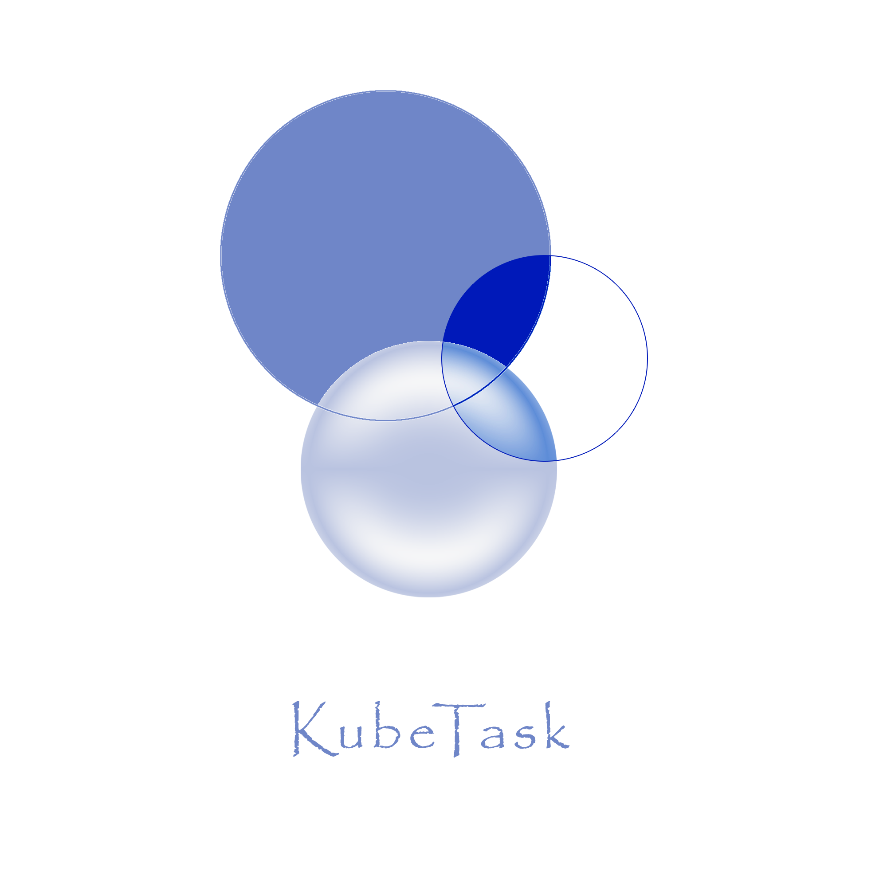
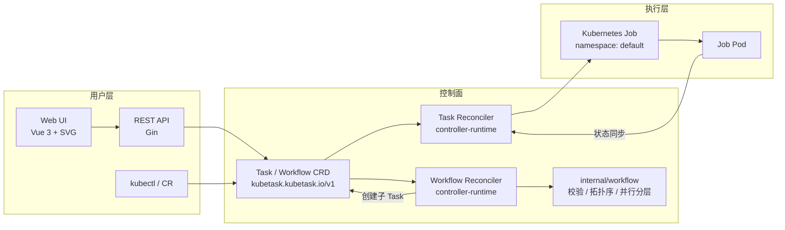

# KubeTask

智能云原生任务调度平台 —— 基于 Kubernetes Operator 模式的轻量级分布式任务调度系统。

KubeTask 用自定义资源（CRD）描述任务与工作流：`Task` 由 Controller 自动转换为 Kubernetes Job 执行，`Workflow` 用扁平 DAG 编排多个 Task 的依赖关系。Vue 3 Web 管理界面与进程内运行的 Gin REST API 打包为同一进程、同一端口交付。相比原生 CronJob，它提供统一的任务视图、任务状态机、执行历史、实时日志、统计趋势和可视化运维界面。

> 定位：轻量、可扩展、易部署，适用于中小团队、边缘计算（k3s）与云原生学习实践。

当前状态（2026-10-26）：P2.0 同端口打包、P2.1 Workflow 编排与视图已实现；P2.2 已完成 ServiceAccount 身份认证和前端 Token 接入，资源授权、租户隔离、API Key、审计仍待实现；P2.3 已实现全局 Webhook MVP，真实集群验收待完成。当前工作区检查结果及验收边界见 [项目状态](docs/PROJECT_STATUS.md)。

## 功能特性

- **Task CRD（Cluster 级）**：`kubetask.kubetask.io/v1`，支持三种任务类型
  - `Cron`：标准 5 字段 Cron 表达式定时调度（`robfig/cron`）
  - `OneTime`：创建后立即执行一次
  - `Delay`：创建后延迟指定时长再执行
- **Controller 自动编排**：Watch Task → 创建/清理 Kubernetes Job，并同步 Job 状态到 Task 状态
  - 状态机：`Pending → Running → Succeeded / Failed / Suspended`
  - 执行历史保留最近 10 条，累计成功/失败次数
  - Finalizer + OwnerReference：删除 Task 时自动清理关联 Job
  - Kubernetes Job Controller 负责失败重试（`backoffLimit`，默认 3），Task 按 Job 终态计数
  - 超时控制（`activeDeadlineSeconds`）与 Job 自动清理（`ttlSecondsAfterFinished`）
  - Cron 并发策略：`Allow` / `Forbid` / `Replace`
  - 手动触发（trigger）、暂停（suspend）、恢复（resume）
- **Workflow CRD（DAG 工作流编排，Cluster 级，短名 `wf`）**：用扁平 DAG 描述多任务依赖
  - `spec.tasks[]` 直接声明节点与 `dependsOn`，没有 entrypoint / templates 间接层
  - 节点执行规格二选一：`template` 引用 `spec.taskTemplates` 命名模板，或内联 `taskSpec`（复用 `TaskSpec`，CEL 强制互斥）
  - `maxParallel` 限制同时运行的节点数；`runOnFailure` 声明失败分支节点
  - 状态模型：Workflow `Pending → Running → Succeeded / Failed`，节点 `Pending / Running / Succeeded / Failed / Skipped`
  - 一个 Workflow CR 即一次运行，子 Task 命名 `<workflow>-<node>`，可确定性幂等创建
- **DAG 校验与拓扑库（`internal/workflow`）**：纯逻辑包，不依赖 Kubernetes 客户端，Controller 只做编排不做图算法
  - Kahn 算法拓扑排序 + 依赖环检测 + 并行分层（`Levels()`）
  - 9 类稳定校验错误码（任务为空、重名、自依赖、未知依赖、重复依赖、模板缺失等），供 API 返回 `reason`、Controller 写入 `status.message`
  - 单元测试覆盖校验规则、拓扑序、分层结果与子 Task 命名
- **REST API**：任务 CRUD、手动触发、暂停/恢复、统计、趋势、SSE 实时日志
- **Web UI（与后端同镜像）**：Vue 3 + Vite + 原生 SVG 图表，提供仪表盘、任务管理、实时日志及工作流列表/详情；Dagre 自动布局 DAG，支持状态着色、缩放、节点详情和子 Task/日志跳转；前端产物由 Dockerfile 自动构建，无需单独部署
- **SSE 流式日志**：通过 Kubernetes API 实时读取 Job Pod 日志，支持 `tail`、`sinceSeconds`、`follow`
- **配置管理**：环境变量 > YAML > 默认值（Viper，`KUBETASK_` 前缀），认证项额外支持显式 Flag 覆盖
- **可选身份认证**：ServiceAccount TokenReview + Bearer 请求头，Web UI 在内存中设置/清除 Token，兼容普通 API 和 fetch SSE；资源授权待实现
- **全局 Webhook**：可选的 Task 执行失败/超时 JSON 通知，包含 Workflow 子任务上下文；异步队列、去重与有限重试，尽力投递
- **结构化日志**：Zap，支持 console / JSON 格式
- **可观测性**：controller-runtime Metrics、健康检查 `/healthz`、就绪检查 `/readyz`
- **Standalone 模式**：未开启认证且无法加载 Kubernetes 配置时，仅 `/healthz` 返回 200，其余请求返回 503 提示
- **一键部署**：多阶段 Dockerfile、Helm Chart、k3s 一键安装脚本

## 架构



Controller 与 HTTP Server 在同一进程中运行：`cmd/main.go` 启动 controller-runtime Manager，并在 goroutine 中启动 Gin 服务。Workflow 的调度由 `WorkflowReconciler` 完成：先用 `internal/workflow` 校验 DAG，再按依赖与 `maxParallel` 创建子 Task，并把子 Task 状态回写到 `status.nodes`，失败分支由 `runOnFailure` 节点承接。

## 快速开始

### 环境要求

- Go 1.27.3（见 `go.mod`）
- Node.js 22.12+ 和 npm（本地构建前端时；Dockerfile 使用 Node 22）
- Docker（构建镜像时）
- kubectl + 一个 Kubernetes 集群（推荐 k3s；测试环境基于 envtest K8s v1.35.0）
- Helm 3（可选，用于 Chart 部署）

### 本地运行

确保 `~/.kube/config` 指向目标集群，然后直接运行：

```bash
kubectl apply -f config/crd/bases/
go run ./cmd/main.go
```

或编译后运行：

```bash
go build -o bin/manager ./cmd/
./bin/manager
```

默认监听：

| 端口 | 用途 |
|------|------|
| `:8080` | Web UI + REST API（Gin，同一端口） |
| `:8081` | 健康检查 `/healthz`、`/readyz` |
| `:8443` | Prometheus Metrics（默认 TLS 安全模式） |

> 如果无法加载 Kubernetes 配置且未开启认证，程序会进入 Standalone 模式，不挂载 Web UI，也不启动 8081/8443 监听。已加载配置但集群不可达时，不保证进入该模式。
> Web UI 静态目录由 `web-dir` 配置指定（默认 `/web/dist`，容器镜像内置）。本机从 `web/` 执行 `npm ci`、`npm run build` 后，回到项目根目录设置 `KUBETASK_WEB_DIR=web/dist` 再启动后端，即可同端口访问 UI 与 API。PowerShell 设置方式为 `$env:KUBETASK_WEB_DIR = 'web/dist'`。

### k3s 一键部署

```bash
bash deploy/k3s/install.sh
```

脚本会自动安装 k3s、构建镜像、导入镜像并 `helm upgrade --install` 部署 KubeTask，最后等待 Pod 就绪。

### Helm 部署

```bash
# 1. 构建镜像
docker build -t kubetask/controller:v0.1.0 .

# 2. 安装
helm install kubetask ./charts/kubetask \
  --set image.repository=kubetask/controller \
  --set image.tag=v0.1.0 \
  --set image.pullPolicy=Never

# 3. 访问 Web UI 与 API（同一端口）
kubectl port-forward svc/kubetask 8080:8080
# 浏览器打开 http://localhost:8080
```
### 部署验证

```bash
curl -s http://localhost:8080/healthz          # {"status":"ok"}
curl -s http://localhost:8080/api/v1/stats     # JSON 统计
curl -s http://localhost:8080/ | head          # SPA index.html
```


### 创建第一个任务

```bash
kubectl apply -f - <<'EOF'
apiVersion: kubetask.kubetask.io/v1
kind: Task
metadata:
  name: hello-kubetask
spec:
  type: OneTime
  image: busybox
  command: ["echo", "Hello from KubeTask!"]
EOF
```

查看任务状态与执行历史：

```bash
kubectl get task hello-kubetask -o yaml
```

### 启动 Web UI（开发模式）

前端源码位于 `web/`。生产部署不需要单独启动前端（镜像构建时已自动产出静态资源），需要独立调试 UI 时可执行：

```bash
cd web
npm ci
npm run dev
```

Vite 开发服务器运行在 `http://localhost:5173`，会自动将 `/api` 代理到 `http://localhost:8080`。
## REST API

完整的请求参数、响应结构、错误码和 SSE 日志说明见 [API 文档](docs/API.md)。

> Workflow 已提供 HTTP API（创建 / 列表 / 详情 / 删除），详情接口会返回前端 DAG 视图需要的节点、边、拓扑序与并行层。

从侧栏「工作流列表」按状态筛选，点击名称进入详情。依赖图支持缩放、适应窗口和节点选择；失败分支使用虚线连接，节点可跳转到子 Task 和日志。运行中的详情默认每 5 秒刷新，终态停止自动请求，也可关闭自动刷新或手动刷新。工作流仍通过 API 或 `kubectl` 创建和删除。

| 方法 | 路径 | 说明 |
|------|------|------|
| `GET` | `/healthz` | 健康检查 |
| `POST` | `/api/v1/tasks` | 创建任务 |
| `GET` | `/api/v1/tasks?page=1&pageSize=20&type=Cron&phase=Running` | 任务列表（分页 + 类型/状态筛选） |
| `GET` | `/api/v1/tasks/:name` | 任务详情 |
| `PUT` | `/api/v1/tasks/:name` | 更新任务 |
| `DELETE` | `/api/v1/tasks/:name` | 删除任务 |
| `POST` | `/api/v1/tasks/:name/trigger` | 手动触发执行 |
| `POST` | `/api/v1/tasks/:name/suspend` | 暂停任务 |
| `POST` | `/api/v1/tasks/:name/resume` | 恢复任务 |
| `GET` | `/api/v1/tasks/:name/logs?tail=100&follow=true&sinceSeconds=60` | SSE 流式日志 |
| `GET` | `/api/v1/stats` | 任务统计（状态分布 + 类型分布） |
| `GET` | `/api/v1/stats/trend` | 按天执行趋势 |
| `POST` | `/api/v1/workflows` | 创建工作流（DAG 编排） |
| `GET` | `/api/v1/workflows?page=1&pageSize=20&phase=Running` | 工作流列表（分页 + 状态筛选） |
| `GET` | `/api/v1/workflows/:name` | 工作流详情（含 DAG 图数据） |
| `DELETE` | `/api/v1/workflows/:name` | 删除工作流（异步清理子 Task） |

示例：

```bash
# 创建 Cron 任务
curl -X POST http://localhost:8080/api/v1/tasks \
  -H 'Content-Type: application/json' \
  -d '{
    "metadata": {"name": "backup-db"},
    "spec": {
      "type": "Cron",
      "schedule": "0 2 * * *",
      "image": "postgres:15",
      "command": ["pg_dump", "mydb"]
    }
  }'

# 查看统计
curl http://localhost:8080/api/v1/stats

# 流式查看日志
curl -N 'http://localhost:8080/api/v1/tasks/hello-kubetask/logs?tail=100&follow=true'
```

## Task CRD 示例

### OneTime（一次性任务）

```yaml
apiVersion: kubetask.kubetask.io/v1
kind: Task
metadata:
  name: data-import
spec:
  type: OneTime
  image: alpine
  command: ["sh", "-c", "wget -qO- http://example.com/data | psql -U app"]
  backoffLimit: 3
  activeDeadlineSeconds: 3600
  ttlSecondsAfterFinished: 300
```

### Cron（定时任务）

```yaml
apiVersion: kubetask.kubetask.io/v1
kind: Task
metadata:
  name: nightly-backup
spec:
  type: Cron
  schedule: "0 2 * * *"          # 每天 02:00（标准 5 字段）
  image: postgres:15
  command: ["pg_dump", "-f", "/backup/db.sql"]
  concurrencyPolicy: Forbid      # Allow / Forbid / Replace
  env:
    - name: PGPASSWORD
      value: secret
  resources:
    requests:
      cpu: 100m
      memory: 128Mi
    limits:
      cpu: 500m
      memory: 512Mi
```

### Delay（延迟任务）

```yaml
apiVersion: kubetask.kubetask.io/v1
kind: Task
metadata:
  name: warmup-cache
spec:
  type: Delay
  delay: 30s                    # 格式："30s"、"5m"、"1h"
  image: busybox
  command: ["sh", "-c", "curl -s https://api.example.com/cache/warmup"]
```

## Workflow CRD 示例（DAG 工作流）

一个 Workflow CR 代表一次 DAG 运行：节点在 `dependsOn` 声明的依赖全部成功后执行；`runOnFailure: true` 的节点等待全部依赖到达终态，至少一个为 `Failed / Skipped` 时执行，全部成功则该节点记为 `Skipped`。下面示例中 `build → test` 串行，`notify-failure` 为失败分支。

```yaml
apiVersion: kubetask.kubetask.io/v1
kind: Workflow
metadata:
  name: workflow-sample
spec:
  maxParallel: 2                # 同时运行的节点上限，0 表示不限制
  tasks:
    - name: build
      template: go-build
    - name: test
      dependsOn: [build]
      template: go-test
    - name: notify-failure
      dependsOn: [test]
      runOnFailure: true        # 仅当依赖失败时执行
      template: notify
  taskTemplates:                # 命名模板，可被多个节点复用
    go-build:
      type: OneTime             # Workflow 节点只允许 OneTime
      image: golang:1.27.3
      command: ["go", "build", "./..."]
      backoffLimit: 3
    go-test:
      type: OneTime
      image: golang:1.27.3
      command: ["go", "test", "./..."]
    notify:
      type: OneTime
      image: curlimages/curl
      command: ["sh", "-c", "echo workflow failed"]
```

也可以省略模板，直接在节点上内联执行规格：

```yaml
    - name: inline-node
      taskSpec:
        type: OneTime
        image: busybox
        command: ["echo", "inline task"]
```

其他约束：`template` 与 `taskSpec` 必须且只能设置一个；节点名需匹配 `^[a-z0-9]([-a-z0-9]*[a-z0-9])?$`；节点数上限 50；DAG 不允许存在依赖环（由 `internal/workflow` 在运行时校验）。

## 配置

配置通过 YAML 和环境变量（`KUBETASK_` 前缀）加载，环境变量优先于 YAML。
新增的认证项还支持命令行参数，优先级为：显式 Flag > 环境变量 > YAML > 默认值。
既有的 `metrics-bind-address`、`leader-elect`、`health-probe-bind-address` 三项 Flag
仍仅注册，未绑定到配置加载器。

配置文件默认查找当前目录或 `./config` 下的 `kubetask.yaml`，也可以通过 `--config <path>` 指定：

```yaml
# kubetask.yaml
api-port: 8080
api-host: "0.0.0.0"
log-level: info          # debug / info / warn / error
log-format: console      # console / json
metrics-bind-address: ":8443"
metrics-secure: true
health-probe-bind-address: ":8081"
leader-elect: true
enable-http2: false
web-dir: /web/dist      # Web UI 静态资源目录（容器内默认）
auth-enabled: false    # 开启后 API 要求 ServiceAccount Bearer Token
auth-audience: ""      # 开启认证时必须显式指定，例如 kubetask
webhook-enabled: false
webhook-url: ""        # 开启时必填，也可通过环境变量从 Secret 注入
webhook-timeout: 5s
webhook-max-retries: 3  # 首次请求之外最多重试三次
```

| 配置项 | 环境变量 | 默认值 | 说明 |
|--------|----------|--------|------|
| `api-host` | `KUBETASK_API_HOST` | `0.0.0.0` | HTTP 监听地址 |
| `api-port` | `KUBETASK_API_PORT` | `8080` | HTTP 端口 |
| `web-dir` | `KUBETASK_WEB_DIR` | `/web/dist` | Web UI 静态资源目录；不存在时仅禁用 UI，不影响 API |
| `auth-enabled` | `KUBETASK_AUTH_ENABLED` | `false` | 开启 HTTP API 的 ServiceAccount 身份认证；也支持 `--auth-enabled` |
| `auth-audience` | `KUBETASK_AUTH_AUDIENCE` | 空字符串 | 预期 Token audience，开启时必填；也支持 `--auth-audience` |
| `webhook-enabled` | `KUBETASK_WEBHOOK_ENABLED` | `false` | 开启全局 Task 失败/超时通知 |
| `webhook-url` | `KUBETASK_WEBHOOK_URL` | 空字符串 | HTTP(S) 接收地址；不接受 userinfo / fragment |
| `webhook-timeout` | `KUBETASK_WEBHOOK_TIMEOUT` | `5s` | 单次请求总超时，1–30 秒 |
| `webhook-max-retries` | `KUBETASK_WEBHOOK_MAX_RETRIES` | `3` | 额外重试次数，0–5；默认共最多四次请求 |
| `log-level` | `KUBETASK_LOG_LEVEL` | `info` | 日志级别 |
| `log-format` | `KUBETASK_LOG_FORMAT` | `console` | 日志格式 |
| `metrics-bind-address` | `KUBETASK_METRICS_BIND_ADDRESS` | `:8443` | Metrics 地址 |
| `metrics-secure` | `KUBETASK_METRICS_SECURE` | `true` | Metrics 是否启用 TLS |
| `health-probe-bind-address` | `KUBETASK_HEALTH_PROBE_BIND_ADDRESS` | `:8081` | 探针地址 |
| `leader-elect` | `KUBETASK_LEADER_ELECT` | `true` | 是否启用 Leader Election |
| `enable-http2` | `KUBETASK_ENABLE_HTTP2` | `false` | 是否启用 HTTP/2 |

> `database-*` 配置项已预留（PostgreSQL 持久化规划中），当前版本尚未使用。

认证开关控制全部 `/api/v1` 端点，健康检查与静态资源保持公开。开启时无法加载
Kubernetes 配置会直接退出；启动不主动探测 TokenReview 权限，运行时审查失败返回 503。
前端可在页面上方「设置 Token」输入 ServiceAccount Token；普通 API 与 SSE 日志均通过
Authorization 请求头发送。Token 仅保存在当前页面内存，刷新后需重新输入；清除或更换会
关闭旧请求并重新加载当前视图。401 提示重新设置 Token，403/503 不清除凭据。认证配置、错误响应与授权边界见
[API 文档](docs/API.md#11-认证配置与路由接入)。

全局 Webhook 在 Job 最终失败时发送 `task.failed`，`DeadlineExceeded` 发送 `task.timeout`；Pod 重试、成功、删除与未创建 Job 的参数错误不发送。首次同步中的旧失败会跳过，重启不补发历史。队列满、进程退出或重试耗尽时可能丢失，接收方应按 `eventId` 去重；本次不提供 Workflow 整体汇总、机器人格式、签名或自定义认证头。协议与运行边界见 [P2.3 方案](PROJECT_PLAN.md#全局通用-webhook-mvp2026-10-26-定案)。

Helm 使用同一命名空间中的已有 Secret 注入地址，例如：

```bash
kubectl -n default create secret generic kubetask-webhook \
  --from-literal=url='https://example.com/hooks/kubetask'
helm upgrade --install kubetask ./charts/kubetask --namespace default \
  --set webhook.enabled=true \
  --set webhook.existingSecret.name=kubetask-webhook
```

Secret 默认 key 为 `url`，可用 `webhook.existingSecret.key` 修改；Chart 不代建 Secret。配置变更后重启 Pod，已有部署也需要先使用包含通知实现的新构建镜像，Chart 默认镜像标签仍是 `v0.1.0`。

## 项目结构

```
kubetask/
├── cmd/main.go                     # 程序入口（Controller + Gin HTTP 同进程）
├── api/v1/                         # Task / Workflow CRD 类型定义
│   ├── task_types.go
│   ├── workflow_types.go           # Workflow 扁平 DAG + CEL 校验规则
│   ├── groupversion_info.go
│   └── zz_generated.deepcopy.go    # 自动生成，勿编辑
├── internal/
│   ├── config/                     # Viper：环境变量 > YAML > 默认值，认证支持显式 Flag
│   ├── logger/                     # Zap 结构化日志
│   ├── auth/                       # ServiceAccount TokenReview 身份认证
│   ├── notification/               # Job 失败观察、全局 Webhook 队列与投递
│   ├── naming/                     # Task 名称长度唯一常量
│   ├── controller/                 # Task / Workflow Reconciler + envtest 测试
│   ├── workflow/                   # DAG 校验 / 拓扑排序 / 并行分层（纯逻辑包 + 单元测试）
│   ├── api/                        # Gin 路由 + Handler（CRUD / 日志 / 统计）+ Web UI 静态托管
│   └── testutil/                   # Windows 下 envtest 进程清理
├── docs/API.md                     # HTTP API 文档
├── web/                            # Vue 3 + Vite + 原生 SVG 图表 前端
├── charts/kubetask/                # Helm Chart
├── deploy/k3s/                     # k3s 一键部署脚本
├── config/                         # Kustomize / CRD / RBAC 清单
├── test/e2e/                       # Kind 集群 E2E 测试
├── Makefile                        # 标准 Makefile（Windows 下不可用，见下）
└── Dockerfile
```

## 开发与测试

### Windows 注意事项

项目当前在 Windows 上开发，`make` 不可用，请直接调用 Go 工具链：

```powershell
# 编译
go build ./...

# 静态检查
go vet ./...

# 重新生成 CRD / RBAC / DeepCopy（controller-gen，注意 Windows 下必须用完整 module 路径）
$gopath = $(go env GOPATH)
& "$gopath\bin\controller-gen" object rbac:roleName=manager-role crd `
  paths="kubetask.io/kubetask/api/v1/...;kubetask.io/kubetask/internal/controller/..." `
  output:crd:artifacts:config=config/crd/bases
```

### 运行测试

测试基于 envtest（etcd + kube-apiserver），需要先准备二进制并设置 `KUBEBUILDER_ASSETS`：

```powershell
go install sigs.k8s.io/controller-runtime/tools/setup-envtest@release-0.23
& "$(go env GOPATH)\bin\setup-envtest" use 1.35.0 --bin-dir bin/k8s -p path

$env:KUBEBUILDER_ASSETS = (Resolve-Path "bin/k8s/k8s/1.35.0-windows-amd64").Path
go test ./... -count=1
```

`internal/testutil` 负责在 Windows 上正确清理 envtest 进程，避免 etcd / kube-apiserver 残留。
默认测试不运行 `e2e` build tag 的 Kind 套件，也不运行 Token 自然过期慢测。
前端修改后在 `web/` 执行 `npm test` 和 `npm run build`，详见 [前端开发说明](web/README.md)。

### 每次修改后的验证流程

```bash
go build ./...
go vet ./...
# 如修改了 CRD 类型，重新生成 controller-gen 产物
go test ./... -count=1
```

## Roadmap

| 版本 | 内容 | 状态 |
|------|------|------|
| **v0.1.0** | MVP：Task CRD + Controller + REST API + Web UI（同端口打包）+ Helm/k3s 部署源码 | ✅ 核心已实现 |
| **v0.2.0** | Workflow + 认证/多租户 + 告警/调度增强 | 🚧 部分完成 |
| ↳ | Workflow CRD 类型、CEL 校验、CRD / RBAC / 样例生成 | ✅ 已完成 |
| ↳ | `internal/workflow` DAG 校验、拓扑库与子 Task 命名 | ✅ 已完成 |
| ↳ | Workflow Reconciler：子 Task 编排、状态回写、失败传播、`maxParallel` 限流、删除清理 | ✅ 已完成 |
| ↳ | Workflow HTTP API 与前端 DAG 视图（列表/详情、Dagre 布局、状态刷新、子 Task/日志跳转） | ✅ 已完成 |
| ↳ | ServiceAccount 身份认证 + Web UI Token / SSE 接入 | ✅ 已实现，默认关闭 |
| ↳ | RBAC 资源授权、Namespace 隔离、API Key、审计 | 🚧 待完成 |
| ↳ | Webhook/钉钉/企微告警、资源感知调度 | 📋 规划中 |
| **v0.3.0** | 多集群管理（k3s + ACK 云边协同）、智能错峰调度、Prometheus + Grafana 可观测性 | 📋 规划中 |

详细设计见 [PROJECT_PLAN.md](PROJECT_PLAN.md)。

## License

Copyright 2026.

Licensed under the [Apache License, Version 2.0](http://www.apache.org/licenses/LICENSE-2.0).
